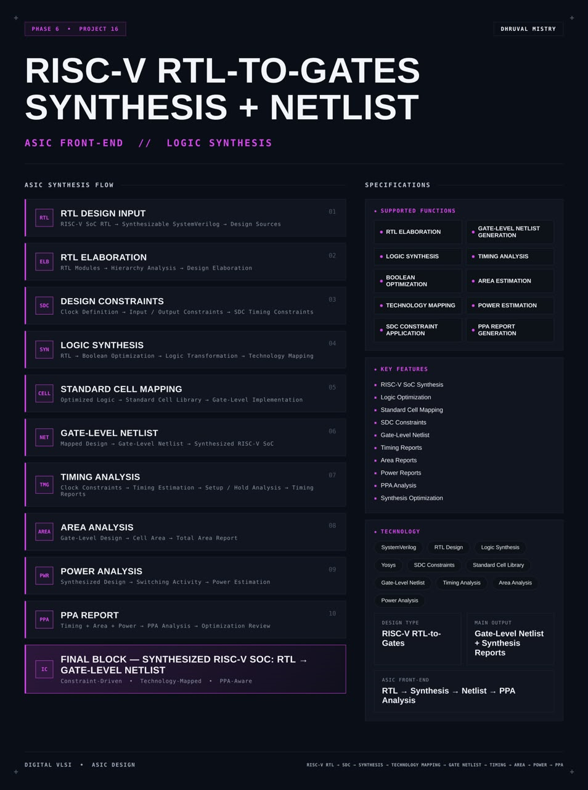
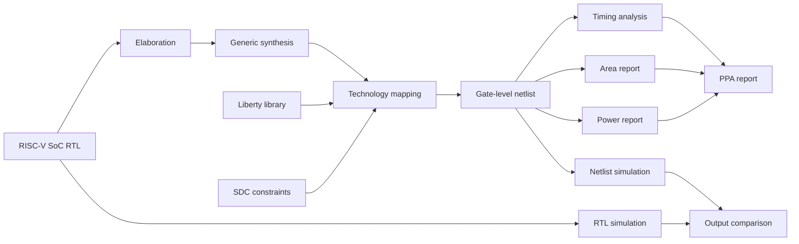
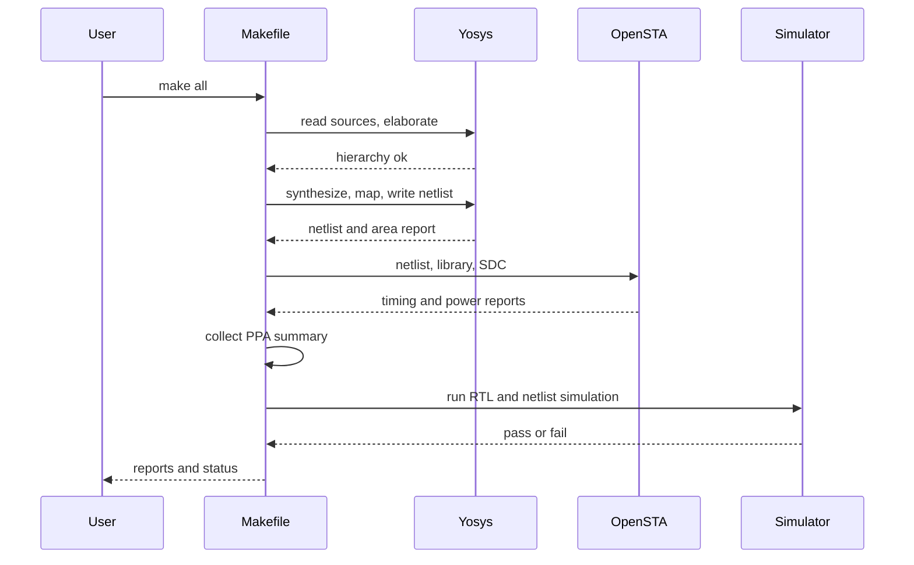
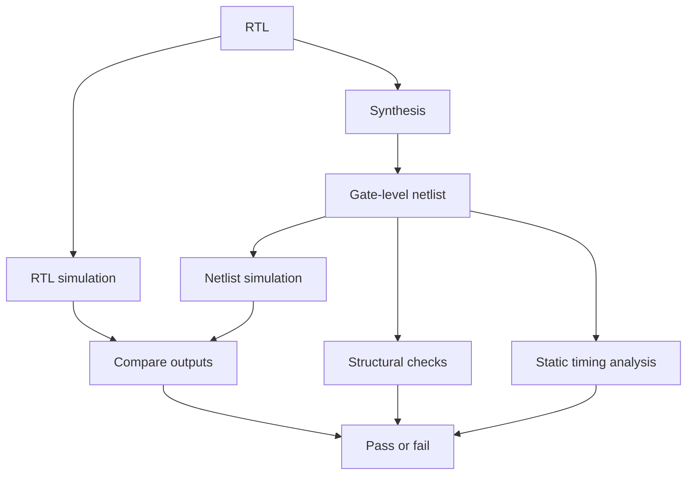
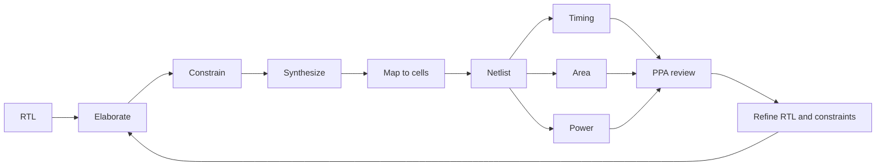

<div align="center">




<b>A constraint-driven, technology-mapped synthesis flow that turns a RISC-V SoC written in SystemVerilog into a gate-level netlist, with timing, area and power reports and a PPA review, using open-source tools.</b>

<br/>


<br/>

[Overview](#overview) |
[At a Glance](#project-at-a-glance) |
[Background](#background-what-synthesis-does) |
[Functions](#supported-functions) |
[Architecture](#architecture) |
[Functional Description](#functional-description) |
[Synthesis Flow](#the-synthesis-flow-step-by-step) |
[Constraints](#design-constraints) |
[Cell Mapping](#standard-cell-mapping) |
[Netlist](#gate-level-netlist) |
[Reports](#timing-area-and-power-reports) |
[PPA](#ppa-report) |
[Getting Started](#getting-started) |
[Verification](#verification) |
[Troubleshooting](#troubleshooting) |
[FAQ](#faq) |
[License](#license)

</div>

---

## Overview

This project implements the **front-end synthesis flow of an ASIC** for a **RISC-V system-on-chip (SoC)**. The input is **synthesizable SystemVerilog RTL**. The output is a **gate-level netlist**, which is the same design expressed only as cells from a **standard cell library**, together with **timing, area and power reports** that describe the quality of the result.

The flow reads the RTL sources and **elaborates** the design hierarchy. It applies **design constraints** written in **SDC**: the clock definition and the input and output timing. **Logic synthesis** then transforms the RTL, optimizes the Boolean logic and maps it onto the **technology library**, so that every gate in the result is a real cell that a foundry process can build. The synthesized design is written as a **gate-level netlist**, and the reports show the **timing**, the **area** and the **power** of the mapped design. A final **PPA review** (power, performance, area) reads these reports together and guides the next round of optimization.

The flow is built on **open-source tools**: **Yosys** performs the synthesis and **OpenSTA** performs the static timing analysis. Everything is driven by scripts and a Makefile, so a complete run is one command and can be repeated exactly. The synthesized netlist is checked by **simulating it against the original RTL** with the same testbench, which confirms that synthesis preserved the behaviour of the design.

<table>
<tr>
<td width="50%" valign="top">

#### Objectives
- Read and elaborate a RISC-V SoC written in synthesizable SystemVerilog
- Apply SDC clock and input and output constraints
- Run logic synthesis with Boolean optimization and technology mapping
- Map the design onto a standard cell library
- Produce a clean gate-level netlist
- Generate timing, area and power reports
- Review the result as a PPA trade-off
- Confirm that the netlist behaves like the RTL

</td>
<td width="50%" valign="top">

#### Key Features
- RISC-V SoC synthesis
- Logic optimization
- Standard cell mapping
- SDC constraints
- Gate-level netlist
- Timing reports
- Area reports
- Power reports
- PPA analysis
- Synthesis optimization

</td>
</tr>
</table>

---

## Project at a Glance

| Attribute | Detail |
|:--|:--|
| **Design type** | RISC-V RTL-to-gates synthesis |
| **Input** | Synthesizable SystemVerilog RTL of a RISC-V SoC |
| **Output** | Gate-level netlist plus synthesis reports |
| **Synthesis tool** | Yosys |
| **Timing tool** | OpenSTA |
| **Constraints** | SDC: clock definition, input delay, output delay |
| **Technology** | Standard cell library in Liberty (`.lib`) format |
| **Mapping** | Sequential cells with `dfflibmap`, combinational cells with `abc` |
| **Reports** | Timing, area, power and a combined PPA summary |
| **Checking** | Netlist simulation against RTL with the same testbench |
| **Automation** | Makefile with Yosys and Tcl scripts |
| **Functions** | 10 (elaboration, constraints, synthesis, mapping, netlist, reports) |
| **Simulation** | Verilator (RTL) and Icarus Verilog or Verilator (netlist) |
| **Waveform analysis** | GTKWave |
| **Target frequency** | TBD |
| **Library used** | TBD |
| **License** | MIT |

---

## Background: What Synthesis Does

A designer describes hardware at the **register-transfer level (RTL)**: registers, and the logic that computes the next value of each register. RTL says what the circuit should do. It does not say which gates to use. **Logic synthesis** is the step that decides this. It turns RTL into a network of gates taken from a technology library, and it does so under a set of goals: meet the clock, keep the area small and keep the power low.

Synthesis is a sequence of well-defined transformations.

**Elaboration.** The tool reads the sources, resolves the module hierarchy, evaluates parameters and generates a netlist of generic operators, such as adders, multiplexers, comparators and flip-flops. Nothing is mapped to a real cell yet.

**Technology-independent optimization.** The generic logic is simplified. Constants are propagated, unused logic is removed, equivalent logic is merged and Boolean expressions are minimized. This stage does not look at the library.

**Technology mapping.** The optimized logic is covered with cells from the standard cell library. Each flip-flop becomes a library flip-flop, and each cluster of combinational logic becomes one or more library gates chosen to fit the timing and area goals.

**Constraints.** Synthesis needs to know how fast the circuit must run. The **SDC** file supplies the clock period and the timing of the inputs and outputs, and these numbers steer the mapping.

**Analysis.** After mapping, **static timing analysis (STA)** adds up the delay along every path and compares it with the clock, so that timing can be judged without simulating a single vector.

The key point is the order of the work. RTL is written once. Synthesis is run many times, with different constraints and options, until the **PPA** balance is acceptable. This repository is the automation that makes that loop short and repeatable.

---

## Supported Functions

| # | Function | Description |
|:-:|:--|:--|
| 1 | **RTL elaboration** | Read the sources, resolve hierarchy and parameters |
| 2 | **Logic synthesis** | Convert RTL processes and operators into generic logic |
| 3 | **Boolean optimization** | Simplify and merge logic, remove unused cells |
| 4 | **Technology mapping** | Cover the logic with standard cells |
| 5 | **SDC constraint application** | Apply the clock period and input and output delays |
| 6 | **Gate-level netlist generation** | Write the mapped design as a Verilog netlist |
| 7 | **Timing analysis** | Check setup and hold with static timing analysis |
| 8 | **Area estimation** | Report the cell area, by cell type and in total |
| 9 | **Power estimation** | Report leakage, internal and switching power |
| 10 | **PPA report generation** | Combine timing, area and power into one review |

---

## Architecture

The architecture of this project is a **flow**: a chain of stages that carries the design from RTL to a netlist, with a report produced along the way.

#### Block diagram

```
          +--------------------------+      +----------------------+
          |  RISC-V SoC RTL          |      |  Standard cell       |
          |  (SystemVerilog)         |      |  library (.lib)      |
          +------------+-------------+      +----------+-----------+
                       |                               |
                       v                               |
          +--------------------------+                 |
          |  RTL elaboration         |                 |
          |  hierarchy, parameters   |                 |
          +------------+-------------+                 |
                       |                               |
                       v                               |
          +--------------------------+                 |
          |  Generic synthesis       |                 |
          |  proc, opt, fsm, memory  |                 |
          +------------+-------------+                 |
                       |                               |
                       v                               v
          +----------------------------------------------------+
          |  Technology mapping                                |
          |  dfflibmap (flip-flops)  |  abc (combinational)    |
          +---------------------+------------------------------+
                                |            ^
                                |            |
                                |     +------+-----------+
                                |     |  SDC constraints |
                                |     |  clock, I/O      |
                                |     +------------------+
                                v
          +--------------------------+
          |  Gate-level netlist      |
          +------+-----------+-------+
                 |           |
                 v           v
     +----------------+  +--------------------+
     | OpenSTA        |  | Area and power     |
     | timing reports |  | reports            |
     +-------+--------+  +---------+----------+
             |                     |
             +----------+----------+
                        v
               +------------------+
               |  PPA report      |
               +------------------+
```

#### Data flow



#### Block breakdown

| # | Block | Role |
|:-:|:--|:--|
| 01 | **RTL design input** | Synthesizable SystemVerilog sources of the RISC-V SoC |
| 02 | **RTL elaboration** | Hierarchy analysis, parameter evaluation, generic netlist |
| 03 | **Design constraints** | SDC clock definition and input and output constraints |
| 04 | **Logic synthesis** | Boolean optimization and logic transformation |
| 05 | **Standard cell mapping** | Optimized logic covered with library cells |
| 06 | **Gate-level netlist** | The mapped design written as a structural Verilog file |
| 07 | **Timing analysis** | Clock constraints, setup and hold analysis, timing reports |
| 08 | **Area analysis** | Cell area per type and total area |
| 09 | **Power analysis** | Power from switching activity and cell data |
| 10 | **PPA report** | Timing, area and power read together |

> **Final design block:** a synthesized RISC-V SoC, taken from RTL to a gate-level netlist, constraint-driven, technology-mapped and aware of PPA.

---

## Functional Description

#### RTL design input

The input is the RTL of the RISC-V SoC: a CPU, memory and peripherals written in synthesizable SystemVerilog. For synthesis the code must follow the synthesizable subset. Behavioural constructs that only make sense in simulation, such as delays, `initial` blocks that depend on time and file access, do not appear in the design sources. A file list names the sources in compile order, and the top module is named explicitly.

#### RTL elaboration

Elaboration builds the hierarchy from the top module down, evaluates parameters and generates the first internal representation of the design. At this point the tool also reports problems such as a missing module, a width mismatch or an unresolved parameter. The elaborated design can be inspected before any optimization, which is useful for confirming that the hierarchy is what the designer expects.

#### Design constraints

The SDC file defines the clock, its period and its uncertainty, and gives the arrival time of each input and the required time of each output. Without constraints, synthesis has no timing goal and maps for area only. With constraints, the mapper knows which paths are critical and spends effort on them.

#### Logic synthesis

The synthesis step converts the process-level RTL into logic. Procedural blocks become multiplexers and flip-flops, state machines are recognised and re-encoded, memories are inferred, and arithmetic operators are expanded. The generic logic is then optimized: constants are propagated, redundant logic is removed and common sub-expressions are shared.

#### Standard cell mapping

The generic flip-flops are replaced by flip-flops of the library, and the combinational logic is mapped by `abc` onto library gates with the clock period as the delay target. The result is a design built only from cells that exist in the technology.

#### Gate-level netlist

The mapped design is written as a structural Verilog netlist. Each line is an instance of a library cell with its connections. This file is the main output of the flow and the input of the later physical design steps.

#### Timing, area and power analysis

The netlist, the library and the constraints are given to OpenSTA, which reports the worst setup and hold slack and the critical paths. The area report adds up the cell areas. The power report estimates leakage, internal and switching power for a given activity.

#### PPA report

The three analyses are collected into a single summary so that the trade-off between speed, size and power can be reviewed in one place and compared between runs.

---

## The Synthesis Flow Step by Step

The flow is a fixed sequence of Yosys commands. The listing below is the shape of the script. Values in angle brackets are set by the user.

| Step | Command | Purpose |
|:-:|:--|:--|
| 1 | `read_verilog -sv` | Read the SystemVerilog sources |
| 2 | `hierarchy -check -top <top>` | Elaborate and select the top module |
| 3 | `proc` | Convert processes into multiplexers and registers |
| 4 | `flatten` | Flatten the hierarchy, unless a hierarchical result is wanted |
| 5 | `opt -full` | Generic optimization: constants, merging, dead logic |
| 6 | `fsm` | Detect and re-encode finite state machines |
| 7 | `memory` | Map memory arrays, or keep them as macros |
| 8 | `techmap` | Reduce operators to simple gates and flip-flop primitives |
| 9 | `dfflibmap -liberty <lib>` | Map flip-flops to library cells |
| 10 | `abc -D <period> -liberty <lib> -constr <file>` | Map combinational logic to library gates |
| 11 | `opt_clean -purge` | Remove leftover unused wires and cells |
| 12 | `hilomap`, `insbuf` | Tie constants to cells and insert buffers where needed |
| 13 | `check`, `stat -liberty <lib>` | Check the design and report cell statistics and area |
| 14 | `write_verilog -noattr` | Write the gate-level netlist |

#### Reference Yosys script

```tcl
# synth.ys (outline, values in angle brackets are set by the user)
read_verilog -sv -defer <rtl_file_list>
hierarchy -check -top <top_module>

# generic synthesis
synth -top <top_module> -flatten
opt -full

# technology mapping
dfflibmap -liberty <lib_file>
abc -D <clock_period_ps> -constr <abc_constr_file> -liberty <lib_file>
opt_clean -purge

# finalize
hilomap -singleton -hicell <tie_hi_cell> <pin> -locell <tie_lo_cell> <pin>
insbuf -buf <buf_cell> <in_pin> <out_pin>
check
tee -o reports/synth_stat.rpt stat -liberty <lib_file>
write_verilog -noattr -noexpr netlist/<top_module>_netlist.v
```

#### Reading the flow

- `synth` runs a standard sequence internally: `proc`, `flatten`, `opt`, `fsm`, `memory`, `techmap`, `abc` in generic mode. It gives a clean generic netlist and is the usual starting point.
- `dfflibmap` and the second `abc` call are what tie the design to the real library.
- `-D` gives the clock period to `abc`, so the mapper tries to meet it.
- `check` reports undriven wires, multiple drivers and combinational loops. A clean `check` is part of the sign-off of the netlist.

---

## Design Constraints

#### What the SDC file contains

The constraints are kept in a single SDC file, written once and read by both the synthesis step (through the clock period) and the timing step (through the whole file).

```tcl
# constraints.sdc (illustrative, values are TBD)
create_clock -name clk -period <period_ns> [get_ports clk]
set_clock_uncertainty <uncertainty_ns> [get_clocks clk]
set_clock_transition  <transition_ns>  [get_clocks clk]

set_input_delay  <in_delay_ns>  -clock clk [remove_from_collection [all_inputs] [get_ports clk]]
set_output_delay <out_delay_ns> -clock clk [all_outputs]

set_driving_cell -lib_cell <driver_cell> [all_inputs]
set_load <load_pf> [all_outputs]

set_false_path -from [get_ports rst_n]
```

| Command | Meaning |
|:--|:--|
| `create_clock` | Defines the clock, its name and its period |
| `set_clock_uncertainty` | Margin for jitter and skew that is not yet known |
| `set_clock_transition` | Slew of the ideal clock before clock tree synthesis |
| `set_input_delay` | Time after the clock edge at which an input becomes valid |
| `set_output_delay` | Time before the clock edge that the outside world needs the output |
| `set_driving_cell` | The cell that is assumed to drive each input |
| `set_load` | The load that each output has to drive |
| `set_false_path` | A path that must not be timed, such as an asynchronous reset |

#### Choosing the clock period

The period is a design decision and not a tool setting. A period that is too tight makes the mapper use larger and faster cells and costs area and power. A period that is too loose gives a small netlist that does not reach the target speed. A common method is to start with a relaxed period, read the critical path, and then tighten the period in steps. The final value is **TBD** for this design.

#### Constraints and the reset

The reset of the SoC is asynchronous in its assertion and synchronous in its release, or fully synchronous, depending on the RTL. The SDC file treats it consistently with the RTL, either as a false path for an asynchronous input or as an ordinary input with a delay.

---

## Standard Cell Mapping

#### Liberty file

The technology library is a **Liberty** (`.lib`) file. For each cell it holds the function, the area, the pin capacitances, the delay and transition tables, the leakage power and the internal power. Yosys reads it to choose cells, and OpenSTA reads it to compute delays. The same library file must be used in every step.

#### Sequential mapping

`dfflibmap` looks in the library for flip-flops that match the registers in the design. It supports the types the library provides, such as a D flip-flop with asynchronous reset. Where the library lacks a needed type, such as a flip-flop with enable, the enable is mapped as a multiplexer in front of the flip-flop.

#### Combinational mapping

`abc` receives the combinational logic as a Boolean network and maps it onto the gates of the library. The target period and the load and drive information shape the choice between small and fast cells.

#### Cells that need special handling

| Item | Handling |
|:--|:--|
| Constant 0 and 1 | `hilomap` ties them to a tie-low and a tie-high cell |
| Buffers for ports | `insbuf` or a buffer-insertion step keeps port nets clean |
| Latches | Mapped only if the library has latch cells, otherwise they are reported |
| Memories | Kept as a behavioural block, replaced by a macro, or built from flip-flops. The choice is TBD |
| Clock gating | Left to the RTL or to a later step. The synthesis flow itself does not add it |

#### Dont-use cells

Some cells in a library should not be used by synthesis, such as very large drive strengths or special-purpose cells. They are excluded with a list so that `abc` ignores them.

---

## Gate-Level Netlist

#### What it looks like

```verilog
// netlist excerpt (illustrative)
module riscv_soc_top (clk, rst_n, uart_rx, uart_tx, gpio_in, gpio_out);
  input  clk;
  input  rst_n;
  ...
  <lib_nand2_cell> U1234 (.A(n100), .B(n101), .Y(n102));
  <lib_dff_cell>   pc_reg_0_ (.D(n102), .CLK(clk), .RN(rst_n), .Q(pc_0_));
  ...
endmodule
```

#### Properties of a good netlist

- Contains only cells that exist in the library, plus the original top-level ports
- Has no unmapped generic operators left
- Has no undriven nets and no multiple drivers
- Keeps the port names and widths of the RTL top module
- Is written without simulation-only attributes so that other tools accept it
- Is deterministic: the same inputs give the same output

#### Using the netlist

| Use | How |
|:--|:--|
| Simulation | Run the same testbench with the library cell models |
| Timing | Read into OpenSTA with the library and SDC |
| Physical design | Hand to the place and route tool with the library and the constraints |
| Comparison | Compare statistics with the previous run |

---

## Timing, Area and Power Reports

#### Timing report

OpenSTA reads the netlist, the Liberty file and the SDC file and reports setup and hold timing.

| Item | Meaning |
|:--|:--|
| **WNS** | Worst negative slack: the slack of the worst path. Zero or positive means the setup is met |
| **TNS** | Total negative slack: the sum of all negative endpoint slacks |
| **Setup slack** | Required time minus arrival time for the longest paths |
| **Hold slack** | Arrival time minus required time for the shortest paths |
| **Critical path** | The path with the worst setup slack |
| **Clock period achieved** | The smallest period at which setup is met, found from the report |

Before clock tree synthesis the clock is **ideal**, so hold violations at this stage are not final. The check is repeated after physical design.

#### Area report

`stat -liberty` reports the cell count and the total cell area, with a breakdown by cell type. The numbers are **TBD**.

| Item | Meaning |
|:--|:--|
| Cell count | Number of instances in the netlist |
| Sequential area | Area of flip-flops and latches |
| Combinational area | Area of gates and buffers |
| Total area | Sum of all cells, before placement and routing |

Wire area is not included. It is added by the physical design flow.

#### Power report

Power comes from the library data and the switching activity of the nets.

| Component | Meaning |
|:--|:--|
| **Leakage power** | Static power drawn whenever the supply is on |
| **Internal power** | Power used inside the cells when their outputs change |
| **Switching power** | Power used to charge and discharge the load capacitance |
| **Total power** | The sum of the three |

The result depends strongly on the **activity** that is assumed. A default toggle rate gives a rough number. Activity taken from a real simulation of the SoC running a program (a `.saif` or `.vcd` file) gives a much better estimate. Which one is used is stated with every result.

---

## PPA Report

**PPA** stands for **power, performance and area**. The three cannot be improved together without limit, and the purpose of the report is to see the trade-off.

| Metric | Source | Value |
|:--|:--|:-:|
| Target clock period | SDC file | TBD |
| Worst setup slack | OpenSTA | TBD |
| Worst hold slack | OpenSTA | TBD |
| Maximum frequency estimate | Timing report | TBD |
| Total cell area | `stat -liberty` | TBD |
| Cell count | `stat` | TBD |
| Leakage power | Power report | TBD |
| Total power | Power report | TBD |

#### How the trade-offs behave

- A tighter clock period increases the **performance** target. The mapper responds with larger and faster cells, which raises **area** and **power**.
- A looser clock period lowers area and power but gives up speed.
- Flattening the hierarchy allows more optimization across module boundaries and often gives a smaller design, but makes the netlist harder to trace back to the RTL.
- Mapping memories to flip-flops can dominate the area of a small SoC. A real design replaces them with SRAM macros.

#### Comparing runs

Each run writes its reports into a folder named after the run. A small script collects the table above from the folders, so that two runs can be placed side by side. A change that improves one metric at the expense of another is easy to see this way.

---
## Interface

The flow has inputs and outputs, and these are the files it exchanges with the user.

#### Inputs

| Input | Format | Description |
|:--|:--|:--|
| RTL sources | `.sv`, `.v` | Synthesizable SystemVerilog of the SoC |
| File list | `.f` | Source files in compile order |
| Top module name | string | Set in the Makefile or the configuration file |
| Liberty library | `.lib` | Standard cell timing, area and power data |
| SDC constraints | `.sdc` | Clock and input and output timing |
| ABC constraints | text | Driving cell and load for `abc` |
| Activity data | `.saif` or `.vcd` | Optional, for power estimation |

#### Outputs

| Output | Format | Description |
|:--|:--|:--|
| Gate-level netlist | `.v` | Mapped design in structural Verilog |
| Synthesis statistics | `.rpt` | Cell counts and area |
| Timing report | `.rpt` | Setup and hold slack, critical paths |
| Power report | `.rpt` | Leakage, internal and switching power |
| PPA summary | `.md` or `.csv` | Combined table of the key metrics |
| Synthesis log | `.log` | Full tool output for each step |

#### Parameters and configuration

| Parameter | Description | Value |
|:--|:--|:-:|
| `TOP` | Top module of the SoC | TBD |
| `CLK_PERIOD` | Target clock period | TBD |
| `LIB` | Path to the Liberty file | TBD |
| `FLATTEN` | Flatten the hierarchy before mapping | TBD |
| `DONT_USE` | Cells excluded from mapping | TBD |
| `INPUT_DELAY`, `OUTPUT_DELAY` | Delays in the SDC file | TBD |
| `ACTIVITY` | Switching activity source for power | TBD |

---

## Operating Sequence

A complete run follows this order. The Makefile runs it automatically.

1. **Prepare.** Set the top module, the clock period and the library path.
2. **Elaborate.** Read the sources and check the hierarchy. Stop here if the sources have errors.
3. **Synthesize.** Run the generic synthesis and optimization.
4. **Map.** Run `dfflibmap` and `abc` with the library and the clock period.
5. **Clean and check.** Remove unused logic and check for undriven or multiply driven nets.
6. **Write the netlist.** Save the structural Verilog file.
7. **Analyze timing.** Read the netlist, library and SDC into OpenSTA and write the timing report.
8. **Report area and power.** Write the statistics and the power report.
9. **Collect PPA.** Build the summary table.
10. **Verify.** Simulate the netlist and compare it with the RTL.

#### Sequence view



---

## Repository Structure

```
risc-v-rtl-to-gates-synthesis-netlist/
|-- README.md
|-- LICENSE
|-- P16B.png
|-- Makefile
|-- rtl/
|   |-- filelist.f
|   `-- (RISC-V SoC SystemVerilog sources)
|-- constraints/
|   |-- constraints.sdc
|   `-- abc.constr
|-- lib/
|   `-- (Liberty file, or a script that fetches it)
|-- scripts/
|   |-- synth.ys
|   |-- synth.tcl
|   |-- sta.tcl
|   |-- power.tcl
|   `-- collect_ppa.py
|-- tb/
|   |-- tb_soc.sv
|   `-- cells_sim.v
|-- netlist/
|   `-- (generated gate-level netlist)
|-- reports/
|   `-- (generated timing, area, power and PPA reports)
|-- logs/
|   `-- (generated tool logs)
`-- sim/
    `-- (generated simulation outputs and waveforms)
```

---

## Technology Stack

| Area | Tool or item | Role |
|:--|:--|:--|
| Design language | SystemVerilog | RTL of the SoC |
| Synthesis | Yosys | Elaboration, optimization, technology mapping |
| Logic mapping | ABC (inside Yosys) | Combinational mapping with delay target |
| Timing and power | OpenSTA | Static timing analysis and power report |
| Constraints | SDC | Clock and input and output timing |
| Library | Liberty `.lib` | Cell function, area, delay and power |
| Simulation | Verilator, Icarus Verilog | RTL and netlist simulation |
| Waveforms | GTKWave | Waveform inspection |
| Automation | Make, Tcl, Python | Run the flow and collect results |
| Visualization | Graphviz (optional) | Draw the design with Yosys `show` |

---

## Getting Started

#### Prerequisites

```bash
# Ubuntu / Debian
sudo apt update
sudo apt install -y yosys iverilog verilator gtkwave graphviz make python3
# OpenSTA is built from source or installed as part of an open-source physical design flow
```

Check the tools:

```bash
yosys -V
sta -version
verilator --version
iverilog -V | head -1
```

#### 1. Clone

```bash
git clone https://github.com/dhruvalmistry2007/risc-v-rtl-to-gates-synthesis-netlist.git
cd risc-v-rtl-to-gates-synthesis-netlist
```

#### 2. Set up the library and the sources

Place the Liberty file in `lib/` and the SoC sources in `rtl/`, then list them in `rtl/filelist.f`.

#### 3. Configure

Set the top module, clock period and library in the Makefile or on the command line.

#### 4. Run the flow

```bash
make synth      # elaborate, synthesize, map, write the netlist
make sta        # timing and power reports with OpenSTA
make ppa        # collect the PPA summary
make sim_rtl    # simulate the RTL
make sim_gate   # simulate the netlist
make all        # everything above
```

Override a setting on the command line:

```bash
make all TOP=riscv_soc_top CLK_PERIOD=<period_ps> LIB=lib/<library>.lib
```

#### 5. Inspect the result

```bash
less reports/synth_stat.rpt
less reports/timing.rpt
less reports/power.rpt
gtkwave sim/netlist.vcd
```

#### Reference Makefile (outline)

```makefile
TOP        ?= riscv_soc_top
CLK_PERIOD ?= TBD
LIB        ?= lib/library.lib
RUN        ?= run0

RTL      := $(shell cat rtl/filelist.f)
NETLIST  := netlist/$(TOP)_netlist.v

all: synth sta ppa sim_rtl sim_gate

synth: $(NETLIST)

$(NETLIST): $(RTL) scripts/synth.ys constraints/abc.constr
	mkdir -p netlist reports logs
	TOP=$(TOP) CLK_PERIOD=$(CLK_PERIOD) LIB=$(LIB) \
	  yosys -c scripts/synth.tcl -l logs/synth.log

sta: $(NETLIST)
	TOP=$(TOP) LIB=$(LIB) sta -no_init -exit scripts/sta.tcl | tee logs/sta.log

ppa: sta
	python3 scripts/collect_ppa.py reports > reports/ppa_summary.md

sim_rtl:
	verilator --binary --timing --trace -f rtl/filelist.f tb/tb_soc.sv --top-module tb_soc -Mdir sim/rtl
	./sim/rtl/Vtb_soc

sim_gate: $(NETLIST)
	iverilog -g2012 -o sim/gate.vvp tb/tb_soc.sv $(NETLIST) tb/cells_sim.v
	vvp sim/gate.vvp

clean:
	rm -rf netlist reports logs sim
```

#### Reference Tcl driver for Yosys (outline)

```tcl
# scripts/synth.tcl, run with: yosys -c scripts/synth.tcl
set top    $::env(TOP)
set period $::env(CLK_PERIOD)
set lib    $::env(LIB)

yosys -import
foreach f [split [read [open rtl/filelist.f]] "\n"] {
    if {$f ne ""} { read_verilog -sv -defer $f }
}
hierarchy -check -top $top
synth -top $top -flatten
opt -full
dfflibmap -liberty $lib
abc -D $period -constr constraints/abc.constr -liberty $lib
opt_clean -purge
check
tee -o reports/synth_stat.rpt stat -liberty $lib
write_verilog -noattr -noexpr netlist/${top}_netlist.v
```

#### Reference OpenSTA script (outline)

```tcl
# scripts/sta.tcl
read_liberty $::env(LIB)
read_verilog netlist/$::env(TOP)_netlist.v
link_design  $::env(TOP)
read_sdc     constraints/constraints.sdc

report_checks -path_delay max -format full_clock_expanded -group_count 5 > reports/timing_setup.rpt
report_checks -path_delay min -group_count 5                              > reports/timing_hold.rpt
report_wns   > reports/wns.rpt
report_tns   > reports/tns.rpt
report_design_area > reports/area_sta.rpt
report_power > reports/power.rpt
```

---

## Verification

Synthesis must not change what the design does. Three kinds of checking apply.



#### Netlist simulation against the RTL

The same testbench and the same program are used for both runs. The testbench applies reset and runs the program on the SoC. It records the signals at the pins of the chip, such as the UART output and the GPIO output, and these are compared between the RTL run and the netlist run. The netlist run uses the **simulation models of the library cells**, which are supplied with the library or written as a small behavioural file.

This is an **equivalence-style check by simulation**. It shows that the two descriptions agree for the tested program. It does not prove equivalence for every possible input. A formal equivalence check is listed under future work.

#### Structural checks

| Check | What it looks for |
|:--|:--|
| `check` in Yosys | Undriven nets, multiple drivers, combinational loops |
| Unmapped cell scan | Any cell in the netlist that is not in the library |
| Port comparison | The netlist top has the same ports and widths as the RTL top |
| Hierarchy check | Hierarchy matches the configuration (flat or kept) |

#### Static timing checks

OpenSTA checks that every path meets setup at the target period and that no path has a hold violation. It also reports unconstrained paths, which show gaps in the SDC file.

#### Test plan

| ID | Test | Expected result | Status |
|:-:|:--|:--|:-:|
| T01 | Elaborate the SoC | No errors, correct top module | TBD |
| T02 | Run `synth` | Completes without errors | TBD |
| T03 | `check` on the mapped design | No undriven nets, no multiple drivers | TBD |
| T04 | Library cell scan | Every cell is in the library | TBD |
| T05 | Port comparison | Same ports and widths as the RTL | TBD |
| T06 | RTL simulation of the test program | Expected UART and GPIO output | TBD |
| T07 | Netlist simulation of the same program | Same output as the RTL run | TBD |
| T08 | Setup analysis at the target period | Non-negative setup slack | TBD |
| T09 | Hold analysis | Non-negative hold slack, or noted as ideal-clock only | TBD |
| T10 | Unconstrained path report | No unconstrained endpoints | TBD |
| T11 | Run twice with the same inputs | Identical netlist | TBD |
| T12 | PPA table | All metrics collected | TBD |

#### Coverage matrix

| Area | Covered by | Status |
|:--|:--|:-:|
| Elaboration | T01 | TBD |
| Generic synthesis | T02 | TBD |
| Technology mapping | T03, T04 | TBD |
| Interface preservation | T05 | TBD |
| Functional equivalence | T06, T07 | TBD |
| Timing | T08, T09, T10 | TBD |
| Repeatability | T11 | TBD |
| Reporting | T12 | TBD |

#### Waveform analysis checklist

- Compare the reset release time in the RTL and netlist waveforms
- Compare the UART transmit line bit by bit between the two runs
- Compare the GPIO outputs at each change
- Check that the netlist run has no unknown (`x`) values after reset
- Note any difference in timing of the outputs. In a zero-delay netlist simulation the outputs should match cycle by cycle
- If delays are annotated, check that outputs settle before the next clock edge

---

## Design Considerations

#### Choices that shape the result

| Choice | Effect |
|:--|:--|
| Clock period | Sets the speed target and the size of the cells |
| Flatten or keep hierarchy | Flat gives more optimization. Hierarchical keeps the netlist readable |
| Memory handling | Flip-flop memories dominate area. Macros are smaller |
| Reset style | Asynchronous resets use larger flip-flops. Synchronous resets add logic |
| FSM encoding | One-hot is faster and larger. Binary is smaller and slower |
| Arithmetic mapping | Adder and multiplier architecture changes both speed and area |
| Dont-use list | Removes cells that should not appear in the netlist |
| Activity data | Decides how realistic the power number is |

#### RTL style that helps synthesis

- Use `always_ff` for registers and `always_comb` for combinational logic
- Assign every output of a combinational block in every branch, to avoid latches
- Avoid initial values that depend on simulation behaviour
- Keep one clock domain per module, and mark any crossing clearly
- Use parameters for sizes, so that the netlist can be re-run for a different configuration
- Avoid very long combinational chains that cannot meet the period

#### Current limitations

- Timing is analysed with an **ideal clock** and **no wire delay**. The real values appear after placement and routing
- Area is the sum of cell areas, without wires or utilization
- The power estimate depends on the activity that is supplied
- Netlist simulation shows equivalence for the tested program, not for all inputs
- Memories are not replaced by SRAM macros in this flow
- The flow does not insert scan chains, clock gating or power gating
- Only a single clock and a single operating corner are used

---

## Applications

- Teaching the complete front-end flow from RTL to gates with open tools
- Baseline for a later place and route run on the same SoC
- Measuring how RTL changes affect timing, area and power
- Comparing standard cell libraries for the same design
- Exploring constraints and clock period trade-offs
- Preparing the netlist and constraints for physical design
- Portfolio project for ASIC front-end, synthesis and STA roles

---

## Customization

#### Change the target clock period

Set `CLK_PERIOD` on the command line and re-run `make all`. The same value goes into the SDC file through a variable, so that the synthesis and timing steps agree.

#### Change the technology library

Point `LIB` to another Liberty file and update the tie cell, buffer cell and dont-use list. Re-run the flow. Everything else stays unchanged.

#### Keep the hierarchy

Remove `-flatten` from the synthesis command and write one netlist module per RTL module. This makes it easier to compare a block with the RTL and to run block-level timing.

#### Add activity-based power

Run the RTL simulation with a program, write a `.vcd` or `.saif` file, and load it in `power.tcl` with `read_vcd` or `read_saif` before `report_power`.

#### Replace a memory with a macro

Mark the memory module as a black box in the synthesis script, and add the macro model to the library and the simulation files.

---

## Troubleshooting

| Problem | Likely cause | What to do |
|:--|:--|:--|
| `read_verilog` reports a syntax error in SystemVerilog | The Yosys front end does not support a construct | Rewrite the construct in plain synthesizable style, or use a front-end plugin that supports more SystemVerilog |
| `ERROR: Module not found` | File missing from the list or wrong top name | Check `filelist.f` and `TOP` |
| Latches appear in the netlist | A combinational block does not assign an output in every branch | Add a default assignment in `always_comb` |
| `dfflibmap` finds no matching flip-flop | The library has no cell of that type | Check the flip-flop type, or map the missing function in logic |
| `abc` reports no timing improvement | The clock period is too loose or too tight to guide the mapping | Change `-D` and compare the reports |
| Cells in the netlist are not in the library | A generic cell was left behind | Run `opt_clean`, check the mapping steps, and scan the netlist |
| OpenSTA says a cell is not found | Library mismatch between Yosys and OpenSTA | Use the same `.lib` file in both |
| `link_design` fails | The top module name does not match | Use the same top name and check for a missing module |
| Many unconstrained paths | The SDC file does not cover all ports | Add `set_input_delay` and `set_output_delay` for each port |
| Large negative slack on the first run | The clock period is far too tight | Relax the period, read the critical path and tighten in steps |
| Netlist simulation shows `x` after reset | Missing reset or a latch in the design | Check reset coverage in the RTL, and the cell models |
| Netlist and RTL outputs differ | Simulation race, missing cell model or a real mapping problem | Compare waveforms, start at the first differing signal and trace back |
| Run is not repeatable | Unordered inputs or random seeds | Fix the order of the file list and avoid time stamps in the output |

---

## FAQ

**What is the difference between RTL and a gate-level netlist?**
RTL describes behaviour with registers and expressions. A gate-level netlist lists the actual library cells and their connections. Synthesis turns the first into the second.

**Why are there two mapping commands?**
`dfflibmap` maps flip-flops and `abc` maps combinational logic. They handle different kinds of cells.

**Why do I need a Liberty file?**
Synthesis needs the area and the delay of every cell to make good choices, and timing analysis needs the same data to compute path delays.

**Why does the design have no wire delay yet?**
Wires exist only after placement and routing. At this stage the timing is an estimate with ideal wires, and the final timing is checked after physical design.

**Why is hold timing not final?**
The clock is ideal here. After clock tree synthesis the skew between flip-flops changes the hold timing, and hold is fixed then.

**Is netlist simulation the same as formal equivalence checking?**
No. Simulation checks the tested cases. Formal equivalence checking proves equivalence for all inputs.

**Does the flow need a commercial tool?**
No. Yosys and OpenSTA are open source, and the library can be an open-source PDK library.

**Why are the results marked TBD?**
They depend on the library, the clock period and the RTL version. They are filled in after the first complete run.

**Can I use this flow for another design?**
Yes. Change the top module, the file list and the constraints.

**What comes after this flow?**
Floorplanning, power planning, placement, clock tree synthesis, routing and physical verification, which use the netlist and the SDC file produced here.

---

## Learning Outcomes

- Reading and writing the steps of an RTL-to-gates flow
- Writing SDC constraints and understanding what each command does
- Using Yosys for elaboration, optimization and technology mapping
- Reading a Liberty file and knowing what it contains
- Running static timing analysis and reading slack and critical paths
- Interpreting area and power reports
- Reviewing results as a PPA trade-off
- Checking that synthesis preserves behaviour
- Automating a flow with Make, Tcl and Python

---

## Design Flow



`RTL -> Elaboration -> SDC -> Synthesis -> Cell Mapping -> Netlist -> Timing / Area / Power -> PPA`

---

## Future Work

- Formal equivalence checking between the RTL and the netlist
- Replace the behavioural memories with SRAM macros
- Scan chain insertion and test coverage
- Clock gating and power-aware synthesis
- Multiple corners and operating conditions for timing
- Post-synthesis power with activity from a full program run
- Continuous integration that runs the flow and compares PPA with the last run
- Hand-off to place and route, with floorplanning and clock tree synthesis

---

## Contributing

Contributions are welcome. To contribute:

1. Fork the repository
2. Create a branch for the change
3. Keep the flow repeatable: no absolute paths and no hidden inputs
4. Run `make all` and include the reports of the run
5. Open a pull request that explains the change and the effect on PPA

Bug reports should include the Yosys and OpenSTA versions, the library name and the log file.

---

## References

- [Yosys Open SYnthesis Suite](https://yosyshq.net/yosys/): open-source RTL synthesis framework
- [Yosys manual](https://yosyshq.readthedocs.io/projects/yosys/en/latest/): command reference, including `synth`, `dfflibmap`, `abc` and `stat`
- [OpenSTA](https://github.com/The-OpenROAD-Project/OpenSTA): open-source static timing analyzer
- [Verilator](https://www.veripool.org/verilator/): open-source SystemVerilog simulator
- [Icarus Verilog](https://steveicarus.github.io/iverilog/): open-source Verilog simulator
- [GTKWave](https://gtkwave.sourceforge.net/): waveform viewer
- Liberty User Guides and Reference Manual: library format specification
- Synopsys Design Constraints (SDC) format: constraint command reference
- IEEE Std 1800: SystemVerilog language standard
- RISC-V International: The RISC-V Instruction Set Manual, Volume I: Unprivileged ISA

---

## License

This project is licensed under the **MIT License**. See the [LICENSE](LICENSE) file for details.

---

## Author

<div align="center">

**Dhruval Mistry**

[](https://github.com/dhruvalmistry2007)

<br/>


</div>
